# Homelab — Dev Studio : IDE web auto-hébergé sur Proxmox

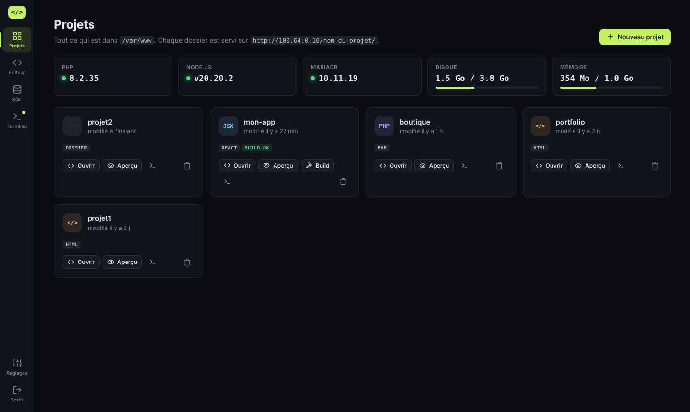

> Mise en place d'un **environnement de développement complet accessible depuis un navigateur** : un conteneur **LXC Debian 12** sur **Proxmox VE**, joignable de partout via **Tailscale**, qui héberge **Nginx**, **PHP 8.2**, **MariaDB** et **Node.js 20**, piloté par **Dev Studio**, une interface web que j'ai développée en **HTML / CSS / JavaScript / PHP** (éditeur de code, gestionnaire de fichiers en glisser-déposer, SGBD graphique, terminal et aperçu des sites).

---

## Sommaire

- [Introduction](#introduction)
- [Fonctionnalités](#fonctionnalités)
- [Technologies utilisées](#technologies-utilisées)
- [Architecture](#architecture)
- [Prérequis](#prérequis)
- [Partie 1 — Création du conteneur LXC](#partie-1--création-du-conteneur-lxc)
- [Partie 2 — Accès distant avec Tailscale](#partie-2--accès-distant-avec-tailscale)
- [Partie 3 — Installation de Dev Studio](#partie-3--installation-de-dev-studio)
- [Partie 4 — Utilisation de Dev Studio](#partie-4--utilisation-de-dev-studio)
- [Sécurité](#sécurité)
- [Commandes utiles](#commandes-utiles)
- [Arborescence du dépôt](#arborescence-du-dépôt)
- [Difficultés rencontrées](#difficultés-rencontrées)
- [Perspectives d'évolution](#perspectives-dévolution)
- [Conclusion](#conclusion)

---

## Introduction

L'objectif de ce projet est d'avoir **un serveur de développement personnel** qui tourne 24h/24 sur mon serveur Proxmox, et sur lequel je peux coder **depuis n'importe quel PC, juste avec un navigateur**, sans rien installer localement.

Le cahier des charges que je me suis fixé :

| Besoin | Réponse apportée |
|---|---|
| **Coder depuis n'importe où** | Conteneur joignable via **Tailscale** (VPN maillé), sans ouvrir de port sur la box |
| **Projets PHP avec base de données** | **PHP 8.2-FPM** + **MariaDB 10.11**, base créée automatiquement pour chaque projet PHP |
| **Projets React** | **Node.js 20** + **npm** + modèle **Vite** prêt à l'emploi, build et serveur de dev lancés depuis l'interface |
| **Tout en interface graphique** | **Dev Studio** : éditeur, explorateur de fichiers, SGBD, terminal, paramètres |
| **Glisser-déposer depuis mon PC** | Envoi de fichiers **et de dossiers entiers** directement dans l'explorateur |
| **Aperçu des sites** | Aperçu intégré à côté du code + ouverture dans un nouvel onglet |
| **Accès protégé** | Connexion par identifiant / mot de passe, mot de passe modifiable dans les Réglages |

### Avantages

| Critère | Détail |
|---|---|
| **Léger** | Un conteneur LXC consomme beaucoup moins qu'une VM : 1 Go de RAM et 2 cœurs suffisent |
| **Accessible partout** | Même environnement depuis la tour, le PC portable ou un PC de l'école, via Tailscale |
| **Rien à installer** | Pas de XAMPP / WAMP / Node en local : tout tourne sur le serveur |
| **Reproductible** | Toute l'installation tient dans **un seul script** relançable sans perte de données |
| **Isolé** | Les expérimentations restent dans le conteneur 105 et n'impactent ni l'hôte Proxmox ni les autres services |

### Inconvénients

| Critère | Détail |
|---|---|
| **Dépendance au réseau** | Sans connexion internet, plus d'accès au serveur (et l'éditeur charge sa coloration syntaxique depuis un CDN) |
| **Pas un IDE complet** | Pas d'autocomplétion intelligente ni de débogueur comme dans VS Code / PhpStorm |
| **Un seul utilisateur** | Pensé pour un usage personnel, pas pour du travail à plusieurs en même temps |

---

## Fonctionnalités

- **Connexion sécurisée** : identifiant + mot de passe haché (bcrypt), session de 7 jours, protection CSRF
- **Projets** : une carte par dossier de `/var/www`, avec détection automatique du type (HTML, PHP, React, Node) et accès direct à l'éditeur, l'aperçu, le build et le terminal
- **Nouveau projet en 1 clic** : 4 modèles — HTML/CSS/JS, PHP + MySQL (avec base créée automatiquement et exemple CRUD), React (Vite, `npm install` + build automatiques), dossier vide
- **Éditeur de code** : onglets multiples, coloration syntaxique (HTML, CSS, JS, JSX, PHP, SQL, JSON, Markdown…), fermeture auto des balises et parenthèses, recherche (Ctrl+F), commentaire (Ctrl+/), enregistrement (Ctrl+S)
- **Aperçu** : le site s'affiche à côté du code et se recharge à chaque enregistrement, ou s'ouvre dans un nouvel onglet
- **Gestionnaire de fichiers** : bouton **Ouvrir** à côté de chaque fichier, création de fichiers / dossiers, renommage, suppression, téléchargement (un dossier est téléchargé en `.zip`), extraction d'archives `.zip`
- **Glisser-déposer** : fichiers **et dossiers complets** depuis le PC, envoi en parallèle avec barre de progression (les dossiers `node_modules` et `.git` sont ignorés)
- **SGBD graphique** : liste des bases et tables, parcours des données avec tri et pagination, ajout / modification / suppression de lignes, structure des tables, **constructeur de table** avec boutons, éditeur SQL avec résultats, export et import `.sql`
- **Terminal** : boutons rapides (`npm install`, `npm run build`, `npm run dev`…), ligne de commande libre avec historique, processus en arrière-plan avec bouton stop, liens cliquables
- **Réglages** : changement du mot de passe (avec jauge de robustesse) et de l'identifiant, identifiants MySQL à utiliser dans ses projets PHP, informations du serveur

---

## Technologies utilisées

| Outil | Rôle |
|---|---|
| **Proxmox VE** | Hyperviseur qui héberge le conteneur |
| **LXC — Debian 12 (Bookworm)** | Conteneur non privilégié `105` (`dev-server`) |
| **Tailscale** | VPN maillé (WireGuard) pour accéder au serveur depuis l'extérieur sans ouvrir de port |
| **Nginx** | Serveur web : sert `/var/www`, le dashboard et transmet les fichiers `.php` à PHP-FPM |
| **PHP 8.2-FPM** | Exécution du PHP (backend de Dev Studio + projets PHP) |
| **MariaDB 10.11** | Base de données (compatible MySQL) |
| **Node.js 20 + npm** | Création et build des projets React / Vite |
| **HTML / CSS / JavaScript** | Interface de Dev Studio (sans framework) |
| **CodeMirror 5** | Composant d'éditeur de code (chargé depuis cdnjs) |
| **Bash** | Script d'installation automatique |

---

## Architecture

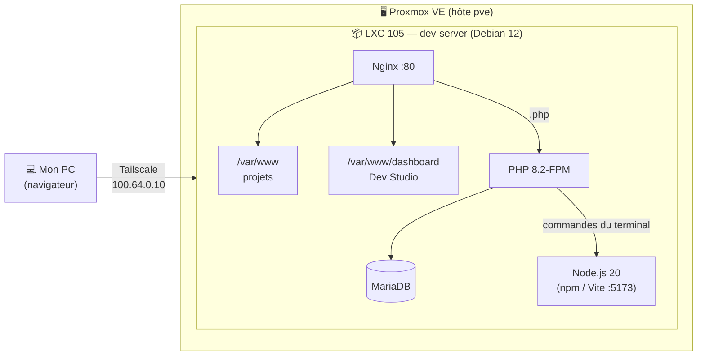

| URL | Contenu |
|---|---|
| `http://<ip>/` | Redirige vers le dashboard |
| `http://<ip>/dashboard/` | **Dev Studio** (protégé par mot de passe) |
| `http://<ip>/<projet>/` | Un projet HTML / PHP |
| `http://<ip>/<projet>/dist/` | Le build d'un projet React |
| `http://<ip>:5173/` | Serveur de développement Vite (`npm run dev`) |

> `<ip>` = l'IP Tailscale depuis n'importe où, ou l'IP locale depuis le réseau de la maison.

---

## Prérequis

- Un serveur **Proxmox VE** fonctionnel, avec accès root en **SSH** (ou au shell de l'interface web)
- Un réseau local avec une IP libre pour le conteneur
- Un compte **Tailscale** (gratuit) et Tailscale installé sur le PC qui doit se connecter
- Environ **4 Go** de disque et **1 Go** de RAM disponibles sur l'hôte

### Ressources

- 📖 [Documentation Proxmox — Linux Containers (pct)](https://pve.proxmox.com/wiki/Linux_Container)
- 📖 [Tailscale — Installation sous Linux](https://tailscale.com/kb/1031/install-linux)
- 📖 [Tailscale dans un conteneur LXC Proxmox](https://tailscale.com/kb/1130/lxc-unprivileged)

---

## Partie 1 — Création du conteneur LXC

Toutes les commandes de cette partie se tapent **sur l'hôte Proxmox**, connecté en SSH :

```bash
ssh root@pve
```

### 1. Télécharger le modèle Debian 12

Proxmox crée les conteneurs à partir de **templates**. On met à jour la liste, on cherche la dernière version de Debian 12 puis on la télécharge dans le stockage `local` :

```bash
pveam update
pveam available | grep debian-12
pveam download local debian-12-standard_12.12-1_amd64.tar.zst
```

> ⚠️ Le numéro de version change régulièrement : utilisez **celui affiché par `pveam available`**, sinon l'erreur `template: no such template` apparaît.

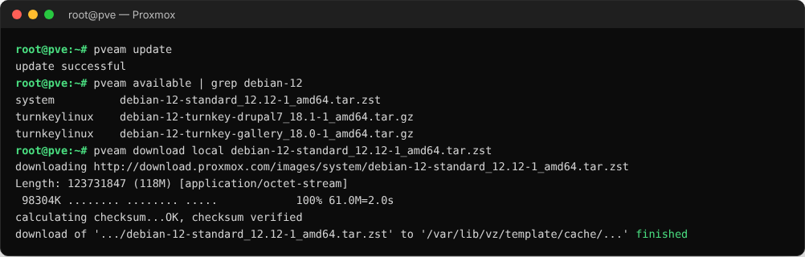

### 2. Créer le conteneur

```bash
pct create 105 local:vztmpl/debian-12-standard_12.12-1_amd64.tar.zst \
  --hostname dev-server \
  --memory 1024 \
  --cores 2 \
  --net0 name=eth0,bridge=vmbr0,ip=192.168.1.100/24,gw=192.168.1.1 \
  --storage local-lvm \
  --unprivileged 1 \
  --password
```

Le mot de passe root du conteneur est demandé deux fois.

| Paramètre | Rôle |
|---|---|
| `105` | Identifiant (VMID) du conteneur |
| `--hostname dev-server` | Nom de la machine |
| `--memory 1024` / `--cores 2` | 1 Go de RAM et 2 cœurs CPU |
| `--net0 ... ip=192.168.1.100/24,gw=192.168.1.1` | IP **fixe** sur le pont réseau `vmbr0` (adapter à votre réseau) |
| `--storage local-lvm` | Le disque (4 Go par défaut) est créé sur le stockage LVM-thin |
| `--unprivileged 1` | Conteneur **non privilégié** : le root du conteneur n'est pas le root de l'hôte (plus sûr) |
| `--password` | Demande le mot de passe root du conteneur |

> ⚠️ Il ne faut **pas** mettre `bootproto=static` dans `--net0` (option de VM, refusée pour un conteneur : `net0.bootproto: property is not defined in schema`). Indiquer une `ip=` suffit pour une IP statique.

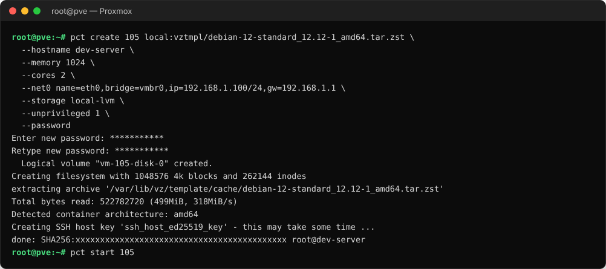

Démarrer le conteneur :

```bash
pct start 105
```

### 3. Activer le nesting et l'accès au périphérique TUN

Deux réglages sont nécessaires sur un conteneur **non privilégié** :

- **`nesting=1`** : sans lui, systemd ne peut pas appliquer ses protections (namespaces) et certains services refusent de démarrer, notamment **MariaDB** (`status=226/NAMESPACE`). C'est aussi ce qu'indique l'avertissement `WARN: Systemd 252 detected. You may need to enable nesting.`
- **`/dev/net/tun`** : Tailscale a besoin de ce périphérique pour créer son interface VPN.

```bash
cat << "EOF" >> /etc/pve/lxc/105.conf
lxc.cgroup2.devices.allow: c 10:200 rwm
lxc.mount.entry: /dev/net/tun dev/net/tun none bind,create=file
EOF

pct set 105 --features nesting=1
pct reboot 105
```

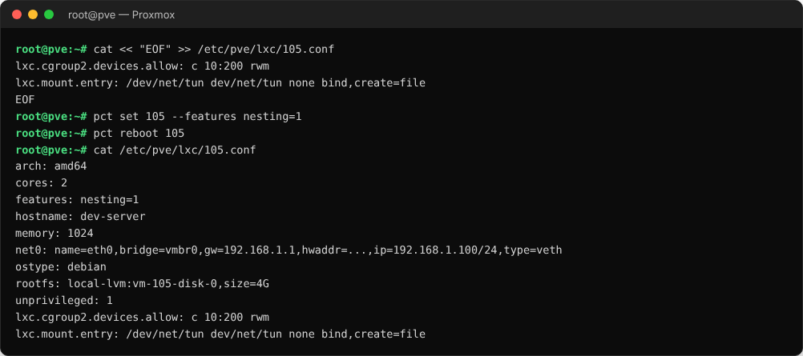

---

## Partie 2 — Accès distant avec Tailscale

**Tailscale** crée un réseau privé chiffré (basé sur WireGuard) entre mes appareils. Le conteneur obtient une IP en `100.x.x.x` joignable depuis tous mes appareils connectés à Tailscale, **sans ouvrir de port** sur la box.

### 1. Installer curl puis Tailscale

L'image Debian minimale ne contient pas `curl`, il faut l'installer d'abord :

```bash
pct exec 105 -- apt update
pct exec 105 -- apt install -y curl
pct exec 105 -- bash -c 'curl -fsSL https://tailscale.com/install.sh | sh'
```

### 2. Connecter le conteneur à son compte

```bash
pct exec 105 -- systemctl enable --now tailscaled
pct exec 105 -- tailscale up
```

Ouvrir le lien `https://login.tailscale.com/a/...` affiché, se connecter à son compte Tailscale et valider : le terminal affiche `Success.`

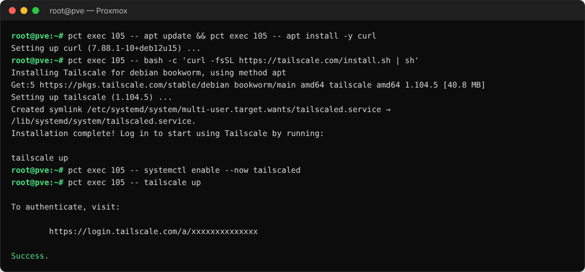

L'IP Tailscale du conteneur s'obtient avec :

```bash
pct exec 105 -- tailscale ip -4
```

> **Exemple :** `100.64.0.10`

---

## Partie 3 — Installation de Dev Studio

Toute l'installation est automatisée par le script [`Script/devstudio-install.sh`](./Script/devstudio-install.sh). Il contient les fichiers de Dev Studio et toute la configuration du serveur.

### 1. Lancer le script

Toujours sur l'hôte Proxmox :

```bash
wget https://raw.githubusercontent.com/yacinehrc/Dev_Studio/main/Script/devstudio-install.sh
pct push 105 devstudio-install.sh /root/devstudio-install.sh
pct exec 105 -- bash /root/devstudio-install.sh
```

| Commande | Rôle |
|---|---|
| `wget ...` | Télécharge le script sur l'hôte Proxmox |
| `pct push 105 <source> <destination>` | Copie un fichier de l'hôte **vers l'intérieur** du conteneur |
| `pct exec 105 -- <commande>` | Exécute une commande **dans** le conteneur |

> 💡 **Variante sans accès internet sur l'hôte** : télécharger le script sur son PC puis l'envoyer avec `scp` depuis PowerShell :
> ```powershell
> scp "C:\Users\<moi>\Downloads\devstudio-install.sh" root@pve:/root/devstudio-install.sh
> ```

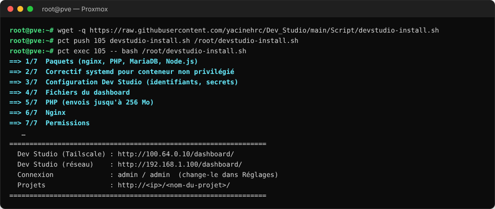

### 2. Ce que fait le script

| Étape | Action |
|---|---|
| **1/7 — Paquets** | Installe Nginx, PHP-FPM (+ extensions `mysql`, `curl`, `gd`, `mbstring`, `xml`, `zip`), MariaDB, Node.js 20 (dépôt NodeSource) et génère la locale `en_US.UTF-8` (supprime les avertissements `perl: warning: Setting locale failed`) |
| **2/7 — Correctif systemd** | Ajoute un *override* pour MariaDB qui désactive les protections systemd incompatibles avec un conteneur non privilégié, puis démarre la base |
| **3/7 — Configuration** | Crée `/var/lib/devstudio/config.json` : compte `admin` / `admin`, mot de passe aléatoire pour l'utilisateur MySQL interne `devstudio`, utilisateur `dev_user` + base `dev_db` pour les projets |
| **4/7 — Fichiers** | Écrit Dev Studio dans `/var/www/dashboard` |
| **5/7 — PHP** | Autorise les envois jusqu'à **256 Mo** et des requêtes de 5 minutes |
| **6/7 — Nginx** | Configure le site : `/var/www` comme racine, exécution du PHP, protection des fichiers cachés (`.env`…) et du dossier interne `dashboard/inc` |
| **7/7 — Permissions** | `/var/www` appartient à `www-data` (l'utilisateur du serveur web) ; le dashboard appartient à `root` pour que les projets PHP ne puissent pas le modifier |

Le script se termine par une **vérification** (services actifs, dashboard qui répond en HTTP 200) et affiche les adresses d'accès.

> ✅ Le script est **relançable sans risque** (par exemple pour une mise à jour) : le mot de passe, les projets et les bases de données sont conservés.

### 3. Se connecter

Ouvrir dans le navigateur :

```
http://100.64.0.10/dashboard/
```

Identifiants par défaut : **`admin`** / **`admin`** — à changer immédiatement dans **Réglages**.

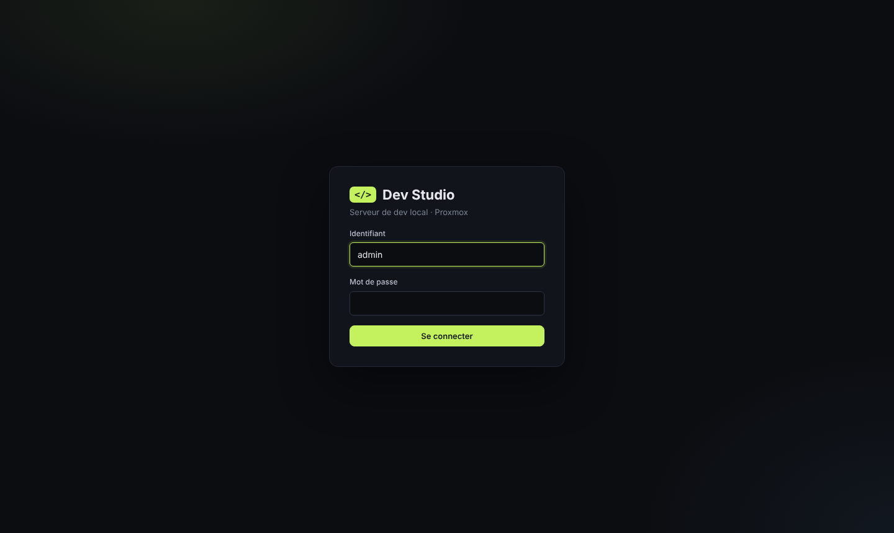

---

## Partie 4 — Utilisation de Dev Studio

L'interface se compose d'une barre latérale avec 5 onglets : **Projets**, **Éditeur**, **SQL**, **Terminal** et **Réglages**.

### Projets

La page d'accueil liste tous les dossiers de `/var/www` sous forme de cartes. Le type est détecté automatiquement (présence d'un `package.json` avec React, de fichiers `.php`, `.html`…). En haut, l'état du serveur : versions de PHP, Node.js et MariaDB, espace disque et mémoire.


Le bouton **Nouveau projet** propose 4 modèles :

| Modèle | Ce qui est créé |
|---|---|
| **HTML / CSS / JS** | `index.html`, `style.css`, `script.js` |
| **PHP + MySQL** | `index.php`, `config.php`, `style.css` + une **base de données du même nom** avec une table `notes` et une application d'exemple (ajout / suppression de notes) |
| **React (Vite)** | `package.json`, `vite.config.js`, `src/App.jsx`… puis lance automatiquement `npm install && npm run build` |
| **Dossier vide** | Un dossier, pour importer son propre code |

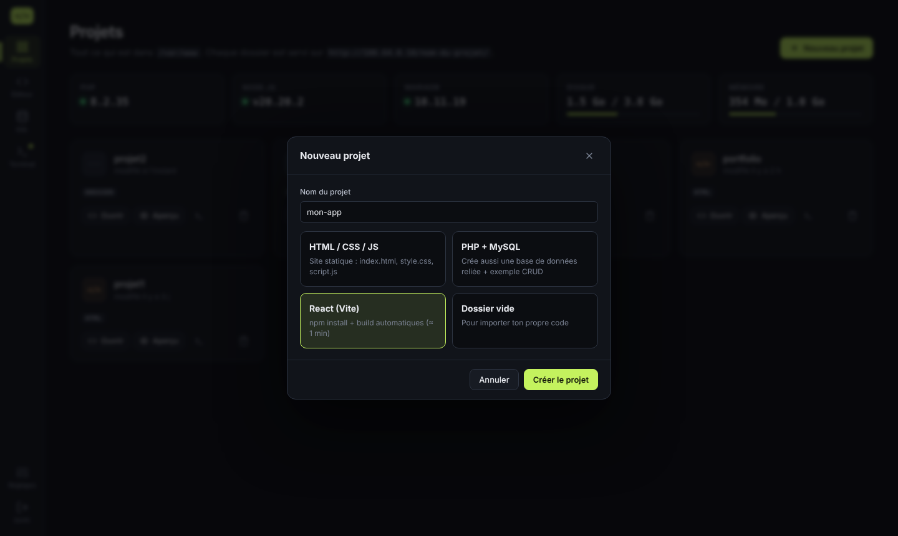

### Éditeur et aperçu

À gauche, l'explorateur de fichiers ; au centre, l'éditeur avec ses onglets ; à droite, l'**aperçu** du site (bouton *Aperçu*), rechargé automatiquement à chaque **Ctrl+S**. Le bouton *Onglet* ouvre le site dans un nouvel onglet du navigateur.

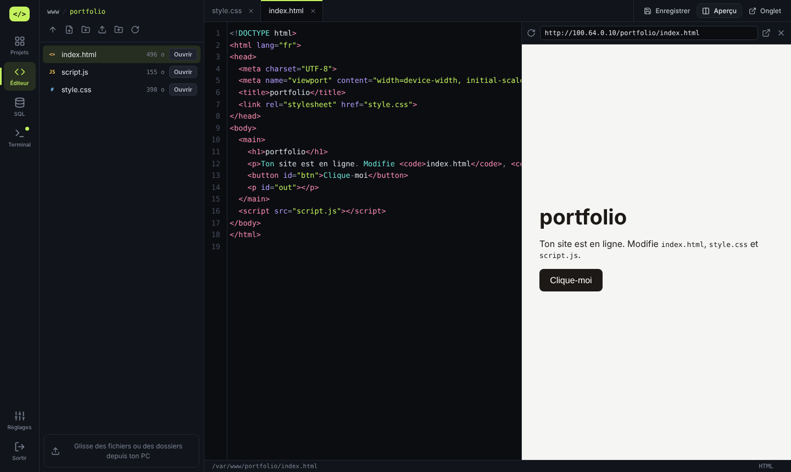

La coloration s'adapte au langage du fichier (ici un composant React en JSX). Un point dans l'onglet signale un fichier modifié mais pas encore enregistré.

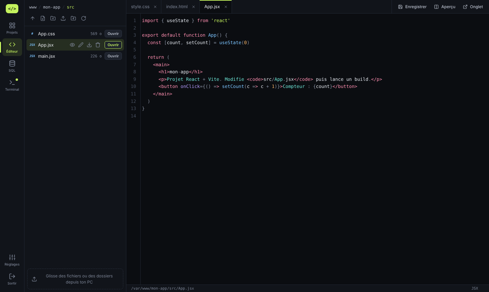

| Raccourci | Action |
|---|---|
| **Ctrl+S** | Enregistrer |
| **Ctrl+F** | Rechercher |
| **Ctrl+/** | Commenter / décommenter |
| **Tab / Maj+Tab** | Indenter / désindenter |

### Gestionnaire de fichiers et glisser-déposer

Chaque fichier possède un bouton **Ouvrir**. Au survol apparaissent les actions : voir dans le navigateur, renommer, télécharger, supprimer (et extraire pour un `.zip`). La barre d'outils permet de remonter d'un dossier, créer un fichier ou un dossier, importer des fichiers ou un dossier complet.

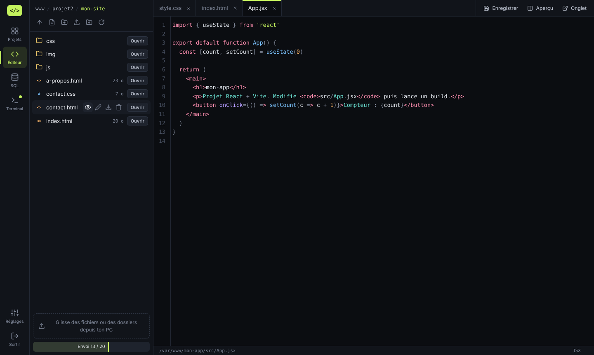

Pour envoyer des fichiers depuis le PC, il suffit de les **glisser dans l'explorateur**. On peut glisser des **dossiers entiers** : l'arborescence est recréée sur le serveur. Lâchés sur un dossier de la liste, les fichiers vont **dans ce dossier**.

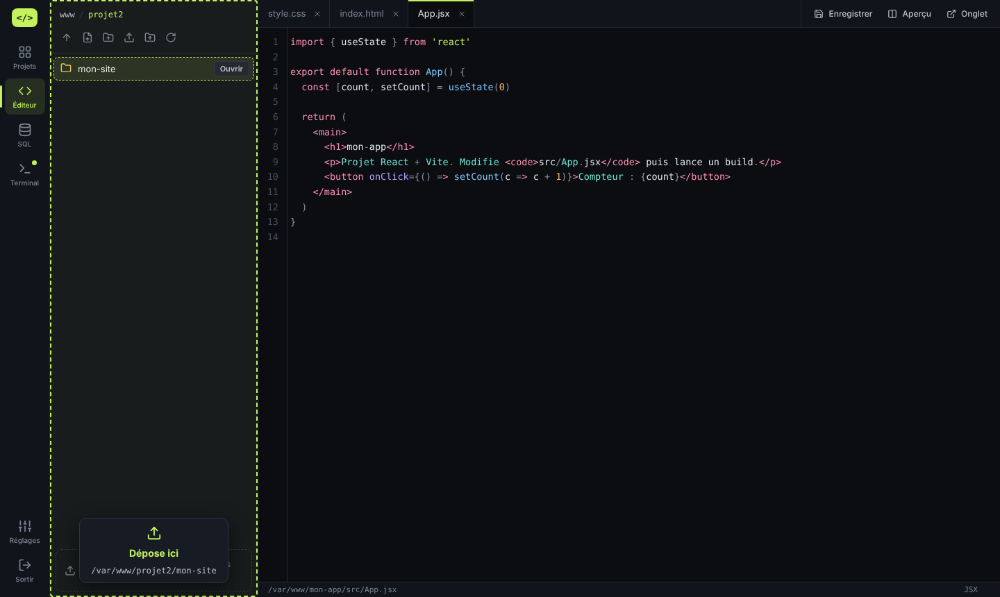

### SGBD (base de données)

L'onglet **SQL** remplace phpMyAdmin. À gauche, les bases et leurs tables (les bases système sont masquées par défaut). Chaque base affiche ses tables, avec des boutons pour créer une table, exporter ou importer un fichier `.sql`, et la ligne de connexion PDO à copier dans son code.

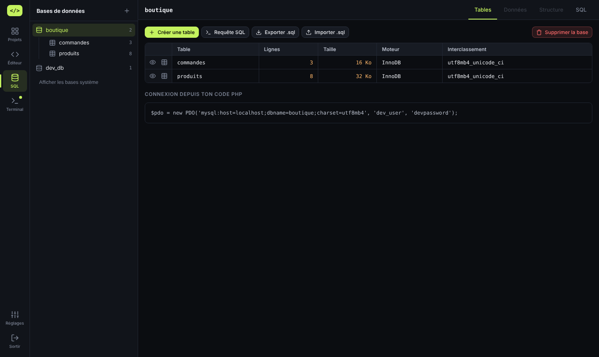

L'onglet **Données** affiche le contenu d'une table : tri en cliquant sur une colonne, pagination, et boutons pour **modifier** ou **supprimer** une ligne (si la table a une clé primaire).

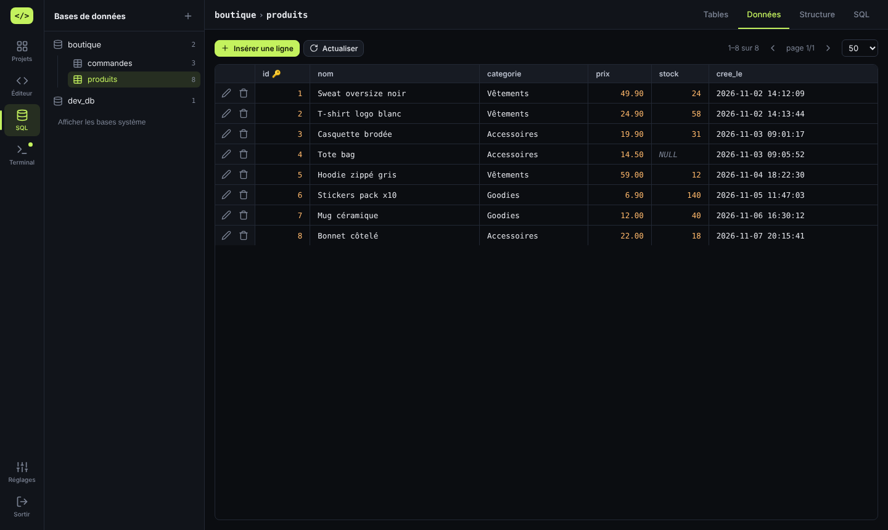

Le formulaire de modification est généré à partir des colonnes de la table ; seuls les champs modifiés sont envoyés.

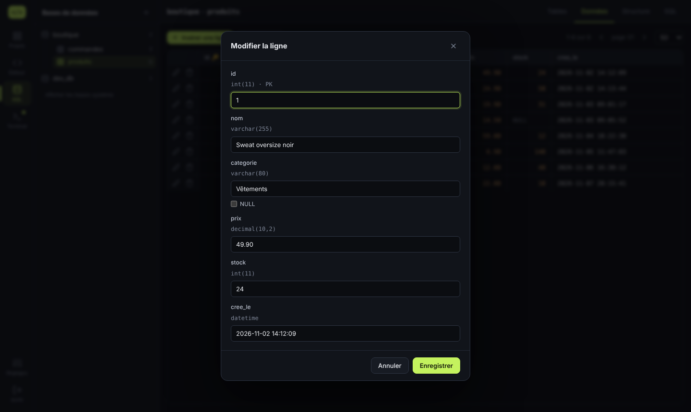

L'onglet **Structure** affiche les colonnes, les index et la requête `CREATE TABLE`, avec des boutons pour renommer, vider ou supprimer la table.

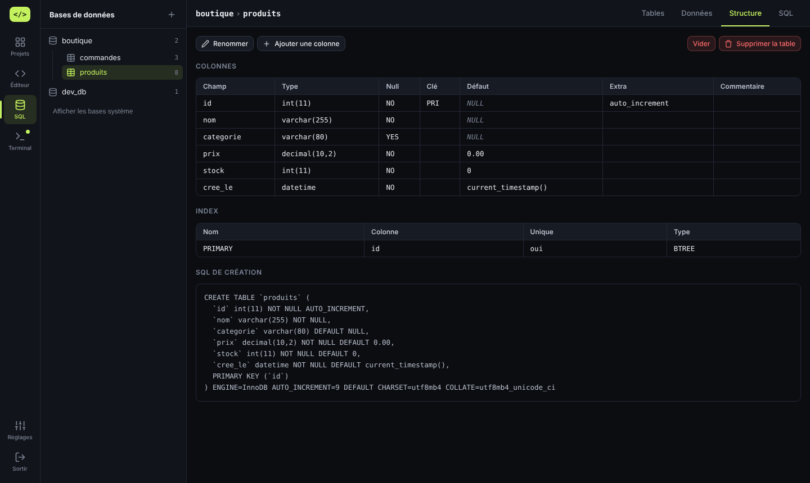

Le **constructeur de table** permet de créer une table sans écrire de SQL : nom, type, taille, valeur par défaut, `NULL`, `AUTO_INCREMENT` et clé primaire. La requête générée s'affiche en direct.

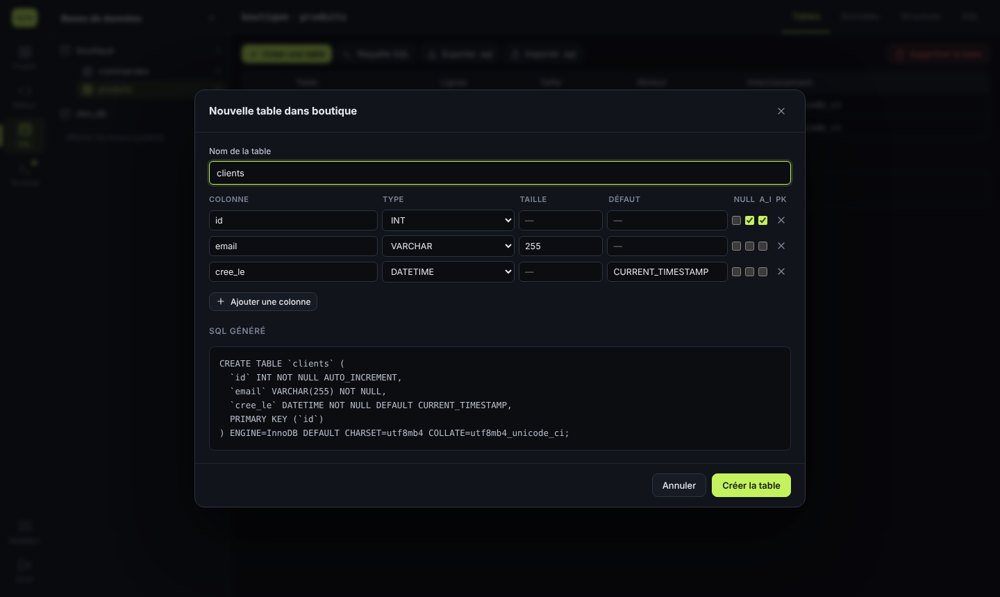

Enfin, l'éditeur **SQL** exécute une ou plusieurs requêtes (**Ctrl+Entrée**) et affiche un résultat par requête : tableau pour un `SELECT`, nombre de lignes affectées pour un `INSERT` / `UPDATE` / `DELETE`. Des modèles (`SELECT`, `INSERT`, `UPDATE`, `CREATE TABLE`) sont disponibles en un clic.

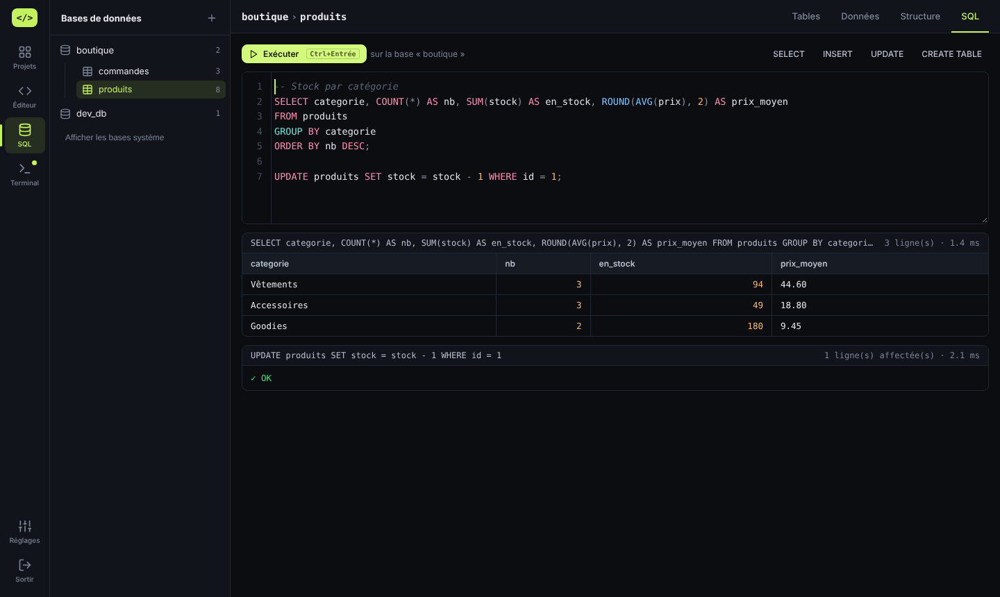

**Connexion depuis un projet PHP :**

```php
<?php
$pdo = new PDO(
    'mysql:host=localhost;dbname=boutique;charset=utf8mb4',
    'dev_user',
    'devpassword',
    [PDO::ATTR_ERRMODE => PDO::ERRMODE_EXCEPTION]
);
```

> Chaque base créée depuis Dev Studio donne automatiquement tous les droits à `dev_user`.

### Terminal et projets React

Le terminal exécute les commandes **dans le dossier du projet choisi**. Les commandes tournent en **arrière-plan** : on peut changer d'onglet pendant un `npm install`, la liste *Processus* à droite indique leur état (en cours, terminé, erreur).

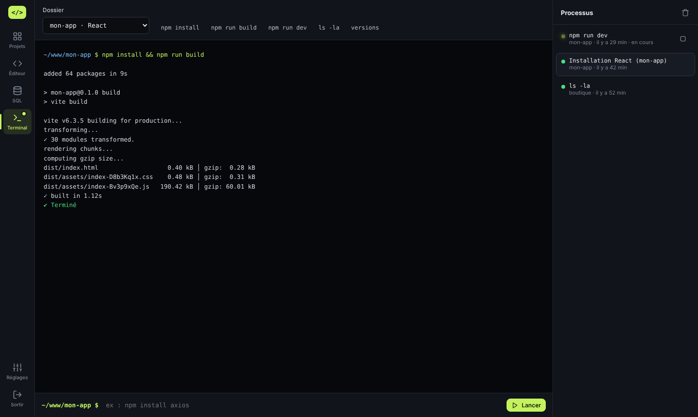

Pour un projet React, deux façons de voir le résultat :

| Méthode | Commande | Adresse |
|---|---|---|
| **Build** (version finale) | `npm run build` | `http://<ip>/<projet>/dist/` (bouton *Aperçu*) |
| **Serveur de dev** (rechargement instantané) | `npm run dev` | `http://<ip>:5173/` (lien cliquable dans le terminal) |

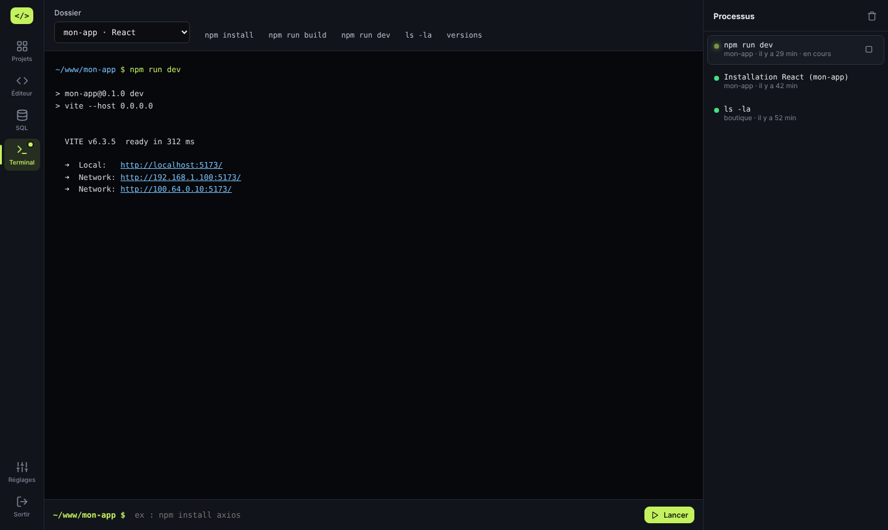

> Le serveur de dev reste lancé jusqu'au clic sur le bouton **■** dans la liste des processus.

### Réglages

Changement du mot de passe (8 caractères minimum, avec jauge de robustesse) et de l'identifiant, identifiants MySQL à utiliser dans les projets et informations du serveur.

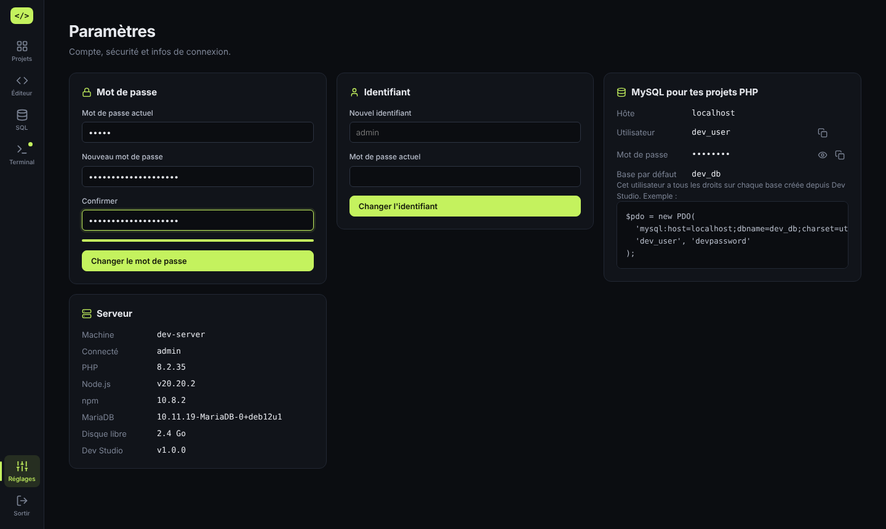

---

## Sécurité

| Mesure | Détail |
|---|---|
| **Pas de port ouvert** | L'accès depuis l'extérieur passe uniquement par **Tailscale** (chiffré, réservé à mes appareils) |
| **Authentification** | Mot de passe haché avec `password_hash()` (bcrypt), délai d'une seconde après un échec pour freiner les essais en boucle |
| **Session** | Cookie `HttpOnly` + `SameSite=Strict`, identifiant de session régénéré à la connexion |
| **Protection CSRF** | Chaque requête d'écriture doit contenir un jeton propre à la session |
| **Confinement des chemins** | Toutes les opérations sur les fichiers sont vérifiées avec `realpath()` : impossible de sortir de `/var/www` (`../`, liens symboliques) |
| **Dashboard protégé** | Le dossier `dashboard` est caché de l'explorateur, interdit via l'API, et appartient à `root` |
| **Secrets hors du web** | La configuration (`/var/lib/devstudio/config.json`, droits `600`) est en dehors de `/var/www` |
| **Requêtes SQL préparées** | Les ajouts / modifications / suppressions de lignes utilisent des requêtes préparées PDO |
| **Utilisateurs MySQL séparés** | `devstudio` (admin, mot de passe aléatoire) pour le dashboard, `dev_user` limité aux bases des projets |
| **Fichiers sensibles** | Nginx refuse l'accès aux fichiers cachés (`.env`, `.git`…) |

> ⚠️ Le terminal permet d'exécuter des commandes en tant que `www-data` : c'est voulu pour un serveur de dev personnel, mais c'est une raison de plus pour **changer le mot de passe par défaut** et ne **jamais exposer** le dashboard directement sur internet.

---

## Commandes utiles

À taper sur l'hôte Proxmox :

| Besoin | Commande |
|---|---|
| Ouvrir un shell dans le conteneur | `pct enter 105` |
| Redémarrer le conteneur | `pct reboot 105` |
| État des services | `pct exec 105 -- systemctl status nginx php8.2-fpm mariadb` |
| Journaux de MariaDB | `pct exec 105 -- journalctl -u mariadb -n 30 --no-pager` |
| IP Tailscale | `pct exec 105 -- tailscale ip -4` |
| Agrandir le disque (+6 Go) | `pct resize 105 rootfs +6G` |
| Sauvegarde complète | `vzdump 105 --mode snapshot --storage local` |
| Mettre à jour Dev Studio | relancer `pct exec 105 -- bash /root/devstudio-install.sh` |
| **Mot de passe oublié** (remet `admin`) | `pct exec 105 -- php -r '$f="/var/lib/devstudio/config.json";$c=json_decode(file_get_contents($f),true);$c["password_hash"]=password_hash("admin",PASSWORD_DEFAULT);file_put_contents($f,json_encode($c,JSON_PRETTY_PRINT));'` |

---

## Arborescence du dépôt

```
Dev_Studio/
├── README.md
├── Images/                       # Captures d'écran du README
├── Script/
│   └── devstudio-install.sh      # Script d'installation tout-en-un
└── Code/
    └── dashboard/                # Code source de Dev Studio (→ /var/www/dashboard)
        ├── index.php             # Page de connexion + structure de l'interface
        ├── api.php               # API JSON : fichiers, projets, SQL, terminal, réglages
        ├── inc/
        │   ├── common.php        # Session, sécurité des chemins, PDO, processus
        │   └── templates.php     # Modèles de projets (HTML, PHP + MySQL, React)
        └── assets/
            ├── app.css           # Thème de l'interface
            └── app.js            # Logique de l'interface (éditeur, SGBD, terminal…)
```

Sur le serveur :

| Chemin | Contenu |
|---|---|
| `/var/www/` | Mes projets (un dossier = un site) |
| `/var/www/dashboard/` | Dev Studio |
| `/var/lib/devstudio/config.json` | Identifiants du dashboard et de MySQL |
| `/var/lib/devstudio/jobs/` | Sorties des commandes lancées depuis le terminal |
| `/etc/nginx/sites-available/default` | Configuration Nginx (l'ancienne est sauvegardée en `default.avant-devstudio`) |
| `/etc/php/8.2/fpm/conf.d/99-devstudio.ini` | Limites d'envoi PHP |

---

## Difficultés rencontrées

| Problème | Cause | Solution |
|---|---|---|
| `template: no such template` | La version `12.2-1` du template n'existait plus | Lister les versions disponibles avec `pveam available \| grep debian-12` |
| `net0.bootproto: property is not defined in schema` | `bootproto` est une option de VM, pas de conteneur | Retirer `bootproto=static`, `ip=` suffit |
| `curl: command not found` | L'image Debian standard est minimale | `apt install -y curl` avant le script Tailscale |
| `tailscaled.sock: no such file or directory` | Pas d'accès à `/dev/net/tun` dans un conteneur non privilégié | Ajout des lignes `lxc.cgroup2` et `lxc.mount.entry` puis redémarrage |
| `perl: warning: Setting locale failed` | Locale `en_US.UTF-8` non générée dans le conteneur | Installation du paquet `locales` + `locale-gen` |
| MariaDB ne démarre pas : `status=226/NAMESPACE` | Les protections systemd de MariaDB nécessitent des namespaces interdits sans *nesting* | `pct set 105 --features nesting=1` + *override* systemd dans le script |
| `bad substitution` et fichiers tronqués | Les longs blocs `cat << EOF` collés dans la console étaient corrompus | Tout regrouper dans **un script** transféré avec `wget` / `scp` puis `pct push` |
| Le PHP n'était pas exécuté | La configuration Nginx d'origine ne transmettait pas les `.php` à PHP-FPM | Nouvelle configuration Nginx avec `fastcgi_pass` |
| Glisser-déposer : `Impossible de créer projet2/mon-site` | 3 fichiers envoyés en parallèle tentaient de créer le même dossier au même moment | Le serveur vérifie que le dossier existe après un `mkdir` échoué (`@mkdir(...) && !is_dir(...)`) |

---

## Perspectives d'évolution

- **HTTPS** avec `tailscale cert` pour un certificat valide sur le nom MagicDNS du conteneur
- **Git intégré** : cloner un dépôt, voir les modifications et faire des commits depuis l'interface
- **Composer** pour les projets PHP (Symfony, Laravel)
- **Terminal interactif** (xterm.js + WebSocket) pour les commandes qui posent des questions
- **Sauvegarde automatique** des projets et des bases (`vzdump` planifié ou export vers mon NAS)
- **Autocomplétion** avancée en remplaçant CodeMirror 5 par Monaco (le moteur de VS Code)

---

## Conclusion

Ce projet m'a permis de construire **mon propre environnement de développement en ligne**, de la création du conteneur LXC jusqu'à une interface web complète. J'ai travaillé à la fois sur la partie **système et réseau** (Proxmox, conteneurs non privilégiés, systemd, Nginx, PHP-FPM, MariaDB, VPN Tailscale) et sur la partie **développement** (API PHP sécurisée, interface JavaScript sans framework, gestion de fichiers, SGBD, exécution de processus en arrière-plan).

Le résultat est un outil que j'utilise au quotidien : je peux créer un site PHP avec sa base de données ou une application React, la coder et la tester **depuis n'importe quel PC**, avec un simple navigateur.

---

*Réalisé par [Yacine Harrache](https://github.com/yacinehrc) — BTS SIO SLAM | EPSI Lille*
